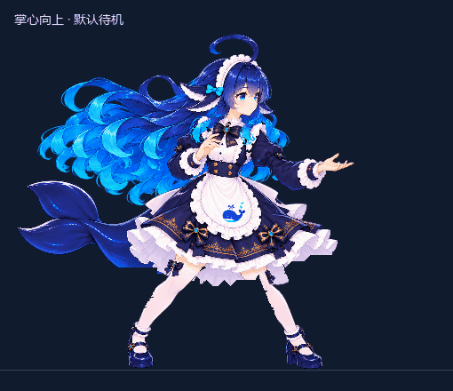

# DeepSeek 娘 · 鲸蓝女仆

《杀戮尖塔 2》故障机器人外观模组，当前版本 **v0.8.6**，适配 **public-beta v0.111.0 / commit 41cef1ea**。

[下载可安装模组](https://github.com/montongyu/DeepSeekMaid/releases/latest) · [查看全部动作](preview/all-actions-v0.8.6.png) · [素材与制作记录](CREDITS.md)



## 功能

- 朝右的鲸蓝女仆人物，50 个原生动画动作及变体，共用张掌待机姿势。
- 待机带呼吸、眨眼、上下层长发错相摆动、发梢回弹、呆毛与鲸尾轻晃。
- 推掌攻击、水盾防御、施法与聚能、短促受击及恼火恢复、趴地死亡与复起。
- 98 项多色卡面插画、五种卡通元素球、选人立绘与深海背景、局内头像。
- 只替换外观；保留游戏原本的数值、规则与动作完成时序。

## 安装

1. 在 [Releases](https://github.com/montongyu/DeepSeekMaid/releases/latest) 下载 `DeepSeekMaid-v0.8.6-beta-v0.111.0.zip`。
2. 退出游戏，解压得到 **DeepSeekMaid** 文件夹。
3. 将整个文件夹放到游戏安装目录的 `mods` 内。最终结构应为：

```text
Slay the Spire 2/
  mods/
    DeepSeekMaid/
      DeepSeekMaid.dll
      DeepSeekMaid.json
      DeepSeekMaid.cfg
      animation/
        maid.spine-json
        maid.atlas
        ...13 张 PNG 纹理
```

更新时整包替换，必须保留 `animation` 子目录。默认严格检查游戏版本；其他 beta 版本需要重新核对接口。

配置位于 `DeepSeekMaid.cfg`，可分别控制人物、卡面、特效、充能球和选人背景，并调整人物高度与特效强度。修改后重启游戏。

## 验证情况

v0.8.6 已通过 C# 编译、补丁接口与 Harmony 应用、卡面映射与资源完整性、原生动画起止和循环检查。11,876 个原生姿态及实际混合姿态、约 7193 万次三角形检查无翻面。

上面的动图来自原生姿态的软件渲染。完整战斗触发、遮挡、GPU 与实际 FPS 尚未验收；下载包未自动部署到游戏。

## 从源码构建

需要合法安装对应 beta 游戏、Python 3、Git，以及 .NET 9 SDK，或构建脚本使用的固定 Roslyn 编译器。构建默认读取 `C:\game\steamapps\common\Slay the Spire 2`；路径不同时，在 `build.ps1` 与需要的验证脚本中传入或设置自己的安装目录。

```powershell
python -m pip install -r requirements.txt
# 使用 build.ps1 时先下载固定编译工具；安装 .NET 9 SDK 后也可用 dotnet build。
.\tools\bootstrap.ps1
python .\tools\make_rig.py
.\build.ps1
```

成品输出到 `dist/DeepSeekMaid`。脚本不复制文件到游戏的 mods 目录。

159 MB 的生成骨骼 JSON、浏览器内嵌数据、临时验证文件、构建工具与历史压缩包不纳入 Git；`make_rig.py` 会从仓库中的图像和作者数据重新生成。源码仓库不包含游戏 DLL、PCK、Spine 运行库或其他模组素材。

[开发与验证步骤](docs/DEVELOPMENT.md) · [v0.8.6 发丝实现](assets/concept/idle-detail-v0.8.6.md) · [原型与生图提示词记录](assets/concept/common-state-v0.8.5-art.md)
